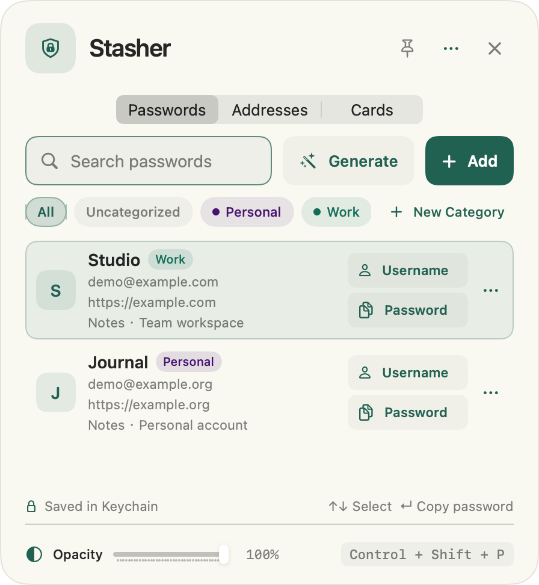

# Stasher

Stasher is a macOS menu bar app for finding and copying website logins, addresses, and cards stored in your local Apple login Keychain. It also generates passwords, passphrases, and PINs and supports password CSV import and export.

<p align="center">
  
</p>

## Build from source

You need macOS 14 or later and Apple's Command Line Tools. To install the tools, run `xcode-select --install`. From the project root, run the following commands.

```sh
./build.sh
open "dist/Stasher.app"
```

On a fresh checkout, the script builds for your Mac's architecture and applies an ad hoc signature. When the app starts, a lock icon appears in the menu bar. Stasher asks macOS to verify your identity once when it starts. Use Touch ID or your Mac login password. The app reuses that session until you quit or select **Lock App**.

## First launch and password prompts

Building or installing the app does not ask for your passwords. The first time you open Stasher, it automatically opens the macOS identity verification dialog. It does not create a separate Stasher master password. A new installation starts with no Stasher records. Add your own records or import a password CSV.

| Action | App verification |
| --- | --- |
| Start Stasher, including after restarting your Mac | Touch ID or your Mac login password |
| Open the panel again or copy another record while Stasher is running | No additional app verification |
| Return after sleep or screen lock | Reuses the app session after you unlock your Mac |
| Select **Lock App**, then unlock Stasher | Verifies your identity again |

Keychain access prompts are separate from app verification. macOS can request permission for an existing item, a locked login Keychain, or a replacement build. **Allow Once** grants access for one request. **Always Allow** can remember access for that app and item. See [Apple's Keychain access guide](https://support.apple.com/en-lb/guide/keychain-access/kyca1243/mac). Stasher does not promise one installation password followed by permanent access without verification.

The free build is not notarized by Apple. Downloaded builds can require approval in **System Settings → Privacy & Security** before first launch. See [Apple's guide to opening apps safely](https://support.apple.com/en-us/102445). Building from source is the documented installation path for this release.

## Use the password panel

Click the lock icon or press `Control + Shift + P` while the app is running. If that shortcut is taken, the app tries `Control + Shift + L`. The footer shows the active shortcut. The panel opens in the top-right corner of the display under your pointer. Drag it to move it. Press `Esc` or click the close button to hide it.

- Search by site name, domain, or username. Select **Username** or **Password** to copy one field. In the row's menu, select **Copy Username and Password** to copy both on separate lines. Use the arrow keys to select a row and press Return to copy its password.
- When you open the panel with a website active in Chrome, **Suggested for this site** shows matches for that domain first, followed by matches for applicable parent domains. For example, a login saved for `notion.com` can appear at `app.notion.com`. The suggestions update when you switch Chrome tabs with the panel pinned. On first use, allow Stasher to access Chrome when macOS asks. The app matches domains locally.
- Select **Add** or press `⌘N` to enter a website URL, username, and password. The site name defaults to the domain. Notes are optional. If you edit an older entry with no username, add one before saving.
- Notes appear below the login details. Hover over the row for the full note.
- When adding a login, click the eye icon to preview the password. The preview hides after 30 seconds, when the panel loses focus, or when you close it.
- Select **Generate** next to **Add** in **Passwords** to generate a random password, passphrase, or PIN. Select **Copy** to copy it, or select **Use Password** to open a new entry with the password filled in. **Use Password** also fills the password field when you open the generator from an add or edit form. Select **Save** to write the entry to Keychain. Passphrases use the [EFF Long Wordlist](https://www.eff.org/dice).
- Select **New Category** below the search bar to add a category. The app keeps empty categories. In the add or edit form, choose an existing category or enter a new name. Each category has a color used in the filter and on entry labels.
- Click the pin to keep the panel above other apps. When the panel is unpinned, it closes when it loses focus or after a successful copy. If you switch apps while editing, you can return to the form.
- Use the **Opacity** slider to adjust the background. The panel stays opaque when **Reduce transparency** is enabled in macOS.

## Save addresses and cards

Choose **Addresses** or **Cards** and select **Add**. Give the record a label you can search for later. For an address, choose a country or region and enter the fields that apply there. Open an address to copy a single field or select **Copy Full Address** to copy the formatted mailing address.

Under **Addresses**, select **Generate** to create up to 20 fictional addresses at a time for form testing. Choose a country or region, set the quantity, and select **Generate**. Copy one address, copy the batch, or select **Use Address** to open an editable record. Select **Save** if you want to keep it in Keychain. The generator works offline and follows the selected country's postal-code format for test data.

For a card, enter the cardholder, number, and expiry date. The security code is optional. Open a card and use the copy button for the field you need. Card numbers and security codes appear masked in the panel. Password CSV import and export apply to website logins.

## Import and export CSV

Open the panel menu and select **Import CSV…**. Choose a UTF-8 file and review the rows before importing. The first row must contain `URL`, `Username`, and `Password` headers. Optional headers are `Title`, `Notes`, and `Category`.

The importer also accepts aliases such as `Website`, `Login Name`, `Name`, and `Remarks`. The Traditional Chinese headers supported by earlier versions still work. Use one header per field in any order.

The app skips entries with the same URL and username, along with incomplete or invalid rows. The maximum file size is 10 MiB.

To export, select **Export CSV…** from the panel menu and choose a local folder that does not sync. The app exports every saved entry, including its URL, username, password, title, notes, and category. Unlock Stasher before exporting.

Password CSV files contain plain-text credentials. If you need to inspect a file, use a plain-text editor so spreadsheet software does not interpret fields as formulas. Use synthetic data when reporting a problem.

## Unlock and lock Stasher

Passwords, addresses, cards, and category settings use Apple's Keychain APIs. The default build stores them in the local login Keychain. Stasher does not create a master password or write a separate password database for daily use.

macOS verifies your identity once per app session. Hiding or reopening the panel does not request another app verification. Sleep and screen lock hide the panel and clear displayed records, forms, and the clipboard content Stasher still owns. The authentication session remains available after you unlock your Mac. Select **Lock App** or quit Stasher to end the session. Unlocking the app again starts a new macOS verification.

macOS also enforces each Keychain item's access rules. Older items can require separate authorization if they do not trust the current app build. Use your existing signing certificate when rebuilding. The [Keychain access tool](Tools/README.md) supports a batch repair for eligible old items in a local installation. This does not guarantee prompt-free access after future app updates.

The sandbox has no network entitlement. Chrome suggestions use macOS Automation and match domains locally. The app writes copied data to the local clipboard. Other apps with clipboard access may read it. After about 30 seconds, when you lock Stasher, when the Mac sleeps or locks, or when Stasher quits normally, it clears content it still owns. If you have since copied something else, the newer content stays on the clipboard.

## Return from the encrypted-vault versions

Existing records from the original Keychain versions are already available. Some pre-release builds used a separate encrypted file. If you added or changed records there, select **Import Encrypted Vault…** from the panel menu and enter that file's old master password once. Stasher imports its records and categories into Keychain.

The import preserves record identifiers, usernames, notes, categories, and wallet fields. Identical records are skipped. Conflicting Keychain records are kept, and the result reports the conflict count. Check those records before retiring the encrypted-vault version. Keychain assigns its own modification dates to newly imported records.

The original encrypted file and its backup are kept. Their master password is still needed to open those old files, but is not needed for normal use after import. See [storage and release notes](docs/releases.md).

## Build and signing options

Run `./build.sh` for the local Keychain version. Apple Developer Program membership is optional. Fresh checkouts use ad hoc signing. If your workspace contains `.local-signing-identity`, the script uses that local certificate. `PASSWORD_REMINDER_SIGNING_IDENTITY` overrides it.

Developers with a Developer ID Application certificate can use `./build.sh --release` for timestamped builds and notarization. This uses the same Keychain storage by default. See [the release guide](docs/releases.md).

The [security review](docs/security-review.md) records the current storage behavior, verification, and remaining limits.

## Prepare source for GitHub

Run `python3 Tools/prepare-source-release.py` to create `dist/Stasher-1.0-source.zip`. The script packages the exact files listed in `Tools/source-release-files.txt`. It excludes the local app, signing identity, Git metadata, credential exports, Keychain files, and encrypted vault files. The screenshot and test records are fictional.

The [GitHub preparation notes](docs/github-readiness.md) record the privacy checks and distribution limits. Extract the source ZIP before uploading its files to a new repository. Keep local runtime data outside the repository.

## Report a problem

Use GitHub Issues for general problems. Include the app version, macOS version, and steps to reproduce with synthetic data. For security vulnerabilities, follow the [private reporting instructions](SECURITY.md).

## License

Stasher is available under the [MIT License](LICENSE). The bundled EFF wordlist and Public Suffix List retain their own licenses. See the [third-party notices](THIRD_PARTY_NOTICES.md).
